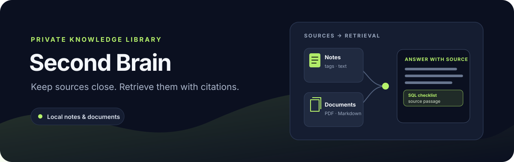

# Second Brain



**A private, local-first library for notes and documents.** Save text, Markdown, PDFs, and public web pages in SQLite, then retrieve source passages with deterministic full-text search and citations.

[](https://github.com/jezannn16/second-brain-bot/actions/workflows/ci.yml)

[Features](#what-it-does) · [Quick start](#quick-start) · [URL import](#import-a-public-url) · [Telegram](#optional-telegram-bot) · [Tests](#tests-and-ci) · [Data and scope](#data-and-scope)

## What it does

| Input | Available now |
| --- | --- |
| Notes and files | Save notes and import `.txt`, `.md`, and `.pdf` files (PDF support is optional) |
| Public pages | Fetch bounded HTTP(S) text/HTML from public IP addresses, validating redirects |
| Retrieval | Search Russian and English text, filter by tag, exact source, and inclusive creation dates, then show source snippets |
| Answers | Return matching passages with citations, or say when there is no evidence |
| Telegram | Optional allow-listed long-poll bot for private save/search/ask workflows |
| Storage | Local SQLite; no account or model API key required |

`ask` is retrieval-only. It does not call an LLM or execute instructions found in stored documents.

## Quick start

Requires Python 3.11 or newer.

```sh
python3 -m venv .venv
. .venv/bin/activate
python -m pip install -e '.[dev]'
# Optional, for PDF extraction:
python -m pip install -e '.[pdf]'
```

Try notes, search, and a cited answer in a throwaway database:

```sh
python second_brain.py --db /tmp/brain-demo.sqlite3 note 'SQL checklist' \
  'For analytics, validate SQL queries against test data before publishing.' --tags work,sql
python second_brain.py --db /tmp/brain-demo.sqlite3 search 'SQL analytics' --tag work
python second_brain.py --db /tmp/brain-demo.sqlite3 ask 'How should analytics SQL be checked?'
python second_brain.py --db /tmp/brain-demo.sqlite3 search 'SQL analytics' --source note --after 2026-01-01 --before 2026-12-31
```

The answer contains a passage from the saved note and its document ID, source, and content version. Search and ask accept `--tag`, `--source` (exact source value), `--after`, and `--before` (`YYYY-MM-DD`, inclusive) filters. Try `ask 'unrelated topic'` to see the no-evidence response.

## Import a public URL

URL import requires network access but no credentials. It accepts public HTTP(S) pages returning HTML or plain text, with an 8 MiB body limit and up to three redirects:

```sh
python second_brain.py --db /tmp/brain-demo.sqlite3 url https://example.com --tags web
python second_brain.py --db /tmp/brain-demo.sqlite3 search 'example domain'
```

Use pages you are permitted to fetch. Private, loopback, and non-public resolved IP addresses are rejected. The fetcher connects to the exact public address it checked, preserves HTTPS certificate/hostname validation, and checks every redirect target.

## Optional Telegram bot

The bot uses long polling and fails closed unless an allowlist is set. It needs a bot token from [BotFather](https://t.me/BotFather) and your numeric Telegram user ID. Keep both in a local `.env` file, which is ignored by Git; never paste a token into an issue, commit, or chat.

```sh
cp .env.example .env
# Edit .env locally: set the BotFather token and only your own numeric user ID.
set -a; . .env; set +a
python telegram_bot.py
```

The bot replies only in private chats to allow-listed users. `/search` and `/ask` support `--tag`, `--source`, `--after YYYY-MM-DD`, and `--before YYYY-MM-DD`; `/more` preserves those filters and shows a next-page command only when more matches exist. `/export` sends the requesting user's sources as a JSON file, capped at 8 MiB. Start with synthetic notes and your own private bot/chat. Revoke a temporary token through BotFather after testing. Uploaded and fetched document content is stored locally.

## Tests and CI

```sh
pytest -q
ruff check .
```

The default suite tests URL validation, redirects, retrieval, and bot behavior with controlled fakes. An optional live smoke test fetches `https://example.com` and verifies the public page can be retrieved; it is skipped unless explicitly enabled:

```sh
RUN_LIVE_TESTS=1 pytest -q -m live
```

This live check performs one public GET and stores nothing remotely. Network availability may affect the result.

## Data and scope

The SQLite database contains raw imported content and, when Telegram is used, Telegram user IDs. On POSIX systems its file permissions are restricted to the current user (mode 0600), but it remains unencrypted; use a private directory and synthetic data for demos. Search uses token frequency without stemming or calibrated ranking. Scanned PDFs may produce no text.

There is no vector search, LLM generation, webhook server, or public hosting. Telegram uploads are capped at 8 MiB; files over 2 MiB require an in-chat confirmation.

See [demo steps](docs/demo.md) and [operator notes](telegram_bot.py) for the local workflow and bot entry point.
